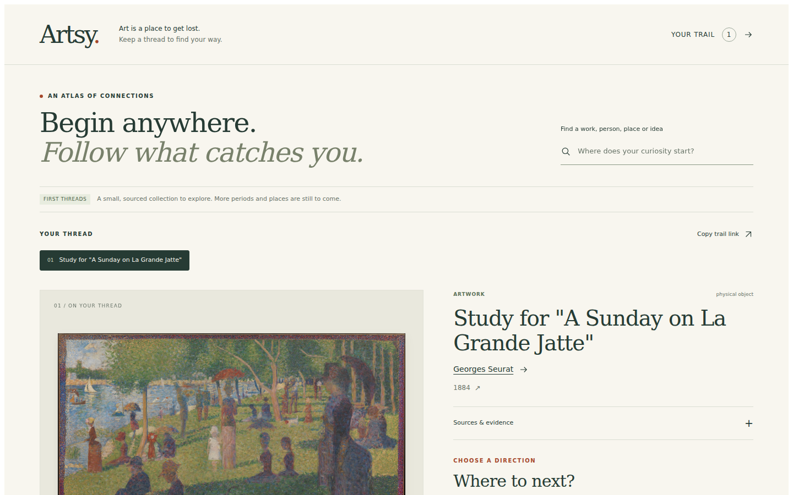

# Artsy — follow a thread through art

An evidence-backed atlas for moving through art vertically and sideways: period → artist → work; work → material → another work; sculpture → gesture → another region; study → finished painting. At every step, see what connects the records and where that assertion comes from.

This repository now contains a **working foundation and implementation-ready domain specs** for that direction. It is a small real dataset and explorable proof, not a finished global art-history platform.

## Try the first threads

```bash
pnpm install --frozen-lockfile
pnpm fixtures:build
pnpm verify
python3 -m http.server 4173 --directory sites/demo/out
```

Open http://localhost:4173 . For development, use `pnpm demo`. The workspace requires Node 22.13+ and pnpm 11.25.0. Museum API credentials are not needed to replay or build the fixture.

The demo begins with **Seurat's Met study → the finished Grande Jatte at the Art Institute of Chicago**. The second starter follows **a Gandharan Buddha → abhaya mudra → a Gupta-period Buddha**. Search also exposes Hokusai's *Great Wave*, the Egyptian hippopotamus commonly called William, their materials, named period definitions and recorded places.

Follow a connection, inspect its evidence, branch from a previous stop, open a larger image, or copy the complete trail URL. Reverse navigation uses the same historical claim and evidence. Image failures preserve the artwork and its relationships.



## What exists

- **Six real artworks**, connected through a validated graph of artists, institutions, materials, places, periods and a gesture. The exact counts/version are in the generated corpus and [implementation status](specs/implementation-status.md).
- **Eight pinned API responses** with retrieval receipts and SHA-256 checks, plus short original curatorial mappings with cited passage locators. Rebuilding the fixture is offline and deterministic.
- Strict runtime schemas, referential/predicate checks, directional adjacency, bounded path search, exact evidence lookup, conservative time comparison and dataset-pinned portable walk state.
- A record-specific image policy. Metadata openness never grants blanket image permission.
- A reusable React explorer consumed by a thin Next.js 16 static-export demo.
- Six package specs, two site specs, Lop/Gauntlet workflows, ownership checks, architecture gates, a source registry and a staged implementation plan.

The production importer, worldwide coverage, regional timeline lanes, map, full two-image comparator, durable branch tree and guided learning runtime remain specified future work. They are not hidden behind green foundation tests.

## Sources and their roles

| Source | Role | Foundation status |
|---|---|---|
| Met Collection API | Object metadata, dates, media and catalogued relationships | Five live-probed objects, pinned replay |
| Art Institute of Chicago API | Final Grande Jatte, artist identity, IIIF image | One artwork + one artist, pinned replay |
| Wikidata | Explicit cross-source identity evidence | One pinned entity; only reviewed identity statement consumed |
| Cleveland Museum of Art | Next broad object/image provider | Documentation researched; adapter planned |
| Getty AAT / ULAN / TGN | Materials, techniques, people/groups and places | Current services/licenses researched; enrichment planned |
| PeriodO | Source-defined, geographically scoped periods | Researched; authority import planned |
| Wikimedia Commons | Additional images with per-file rights | Planned, never blanket licensed |
| Rijksmuseum, Smithsonian, Europeana, Japan Search, Te Papa | Collection and regional expansion | Source-specific access/rights documented; not imported |

See [source research](specs/research/sources.md), the [machine-readable registry](data/sources/registry.json), and the [coverage matrix](specs/research/coverage.md). Documentation verification, successful record probes and production adapter readiness are distinct statuses.

The research accounts for the Met's **2026 search endpoint migration** and Getty's **2026 retirement of XML services**. New imports must use the documented current interfaces, not old example URLs.

## Relationships are the product

Facts are evidence-bearing claims. A claim records its subject, controlled predicate, entity or scalar object, evidence IDs, source basis, status and qualifiers. Inverse traversal is a view of that same claim. Periods have named schemes and regional scope; they can overlap and disagree.

The model deliberately distinguishes:

- Production place, depicted place, archaeological findspot and institutional collection.
- Artwork, visual design, physical impression and digital image.
- Catalogue assertion, scholarly interpretation, editorial comparison and computed suggestion.
- Source display dates, historical occurrence windows and provider search-index windows.
- A documented historical influence from a similar-looking image.

The Great Wave fixture is an adversarial example: its displayed date is approximately 1830–32, while the provider indexes 1820–1842. The latter is typed `index-window` and cannot establish historical overlap. William's BCE range and Meir findspot are preserved independently of the museum that holds it.

Canonical contracts are in [`packages/core/src/contract.ts`](packages/core/src/contract.ts). The model is informed by Linked Art, CIDOC CRM, PeriodO and EDTF; it does not claim complete standards conformance.

## Package and site boundaries

| Domain | Owns |
|---|---|
| [core](packages/core/SPEC.md) | Canonical schema-adjacent validation, labels and time-claim access |
| [ingest](packages/ingest/SPEC.md) | Provider boundaries, raw receipts, replay, source/coverage registry and future reconciliation |
| [graph](packages/graph/SPEC.md) | Relationships, explanations, route discovery and portable paths |
| [media](packages/media/SPEC.md) | Independent image eligibility and selection |
| [explorer](packages/explorer/SPEC.md) | Accessible focus, trail, next directions, search and evidence surface |
| [learning](packages/learning/SPEC.md) | Reserved: cited guided walks and context |
| [demo](specs/sites/demo.md) | Thin integration artifact for the engine and critics |
| [atlas](specs/sites/atlas.md) | Planned public site, coverage and regional exploration |

Read [engine architecture](specs/00_engine.md), [Lop](.agent/workflows/lop.md), [Gauntlet](.agent/workflows/gauntlet.md) and [the work plan](specs/engine-plan.md). A bubble has scoped writes. Contracts/manifests/workflows are PM-owned. Fresh critics inspect real artifacts against named external bars and return one largest gap; builders do not grade themselves.

The existing `frontend/`, its specs and `docs/product/` belong to the previous editorial direction and remain as reference. New packages do not import them. Their existing CI is separate from root workspace verification.

## Verification

```bash
pnpm spec:check          # bars, verification targets, status and disjoint ownership
pnpm check               # strict TypeScript across implemented packages/site
pnpm test                # meaningful package tests
pnpm test:architecture   # dependency direction, public imports and PM write exclusions
pnpm build               # actual static export
pnpm exec playwright install chromium
pnpm test:browser        # serves the export and exercises desktop/mobile routes
```

`pnpm verify` combines the first five technical gates. `pnpm fixtures:build` regenerates the pinned corpus and import report; CI also rejects uncommitted fixture changes after replay. Browser checks save evidence under `artifacts/browser/`. The test runner has an opt-in `ARTSY_TEST_IGNORE_HTTPS_ERRORS=1` for a controlled test environment with an intercepting proxy; it changes no application behavior and is not the CI default.

For a domain branch: `pnpm scope:check --domain graph --base <PM-provided-base-sha>`. This checks committed/uncommitted and untracked changes against that domain's gate. The PM integration branch intentionally spans domains.

See [current results and limits](specs/implementation-status.md) and [independent reviews](specs/reviews/). Technical gates and a quality verdict are different deliverables. No production deployment or merge is implied by this foundation.
